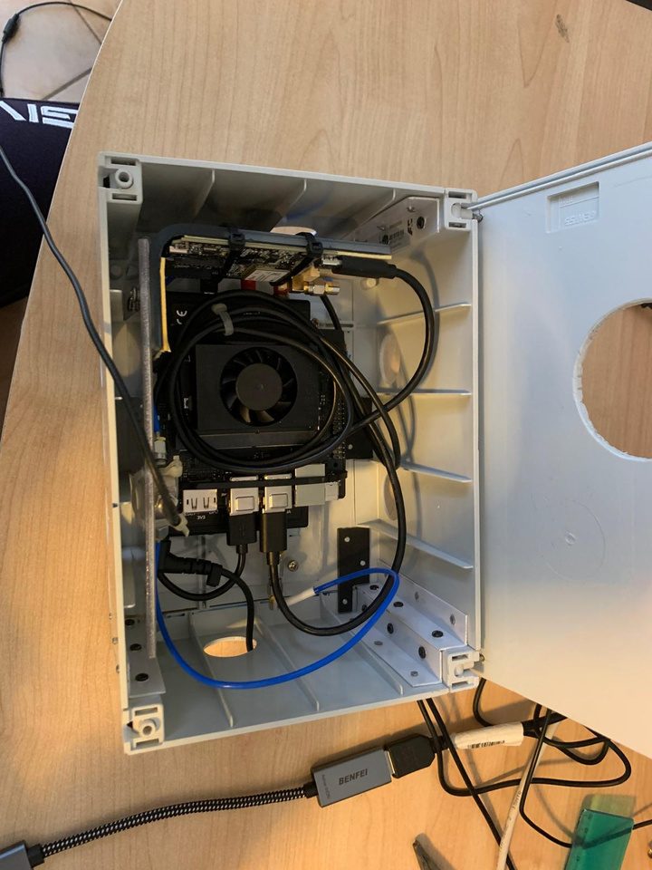
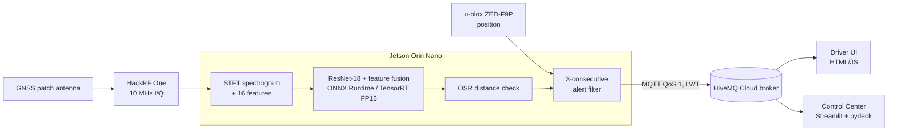
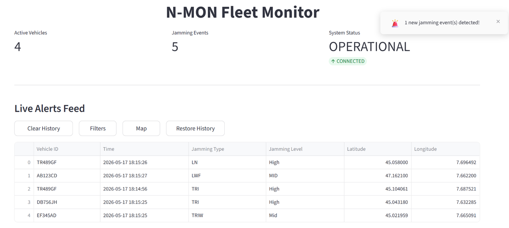
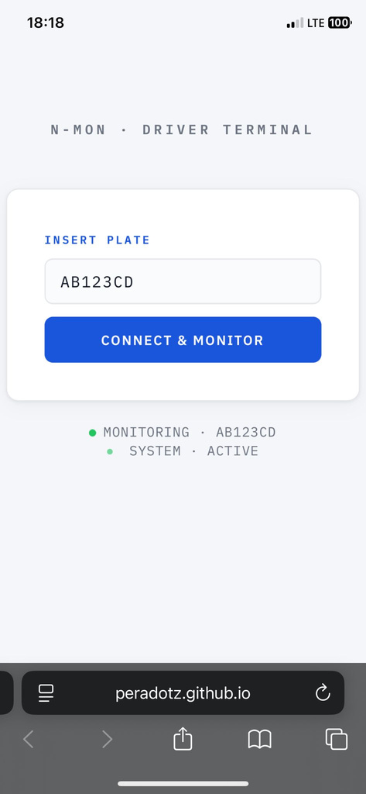
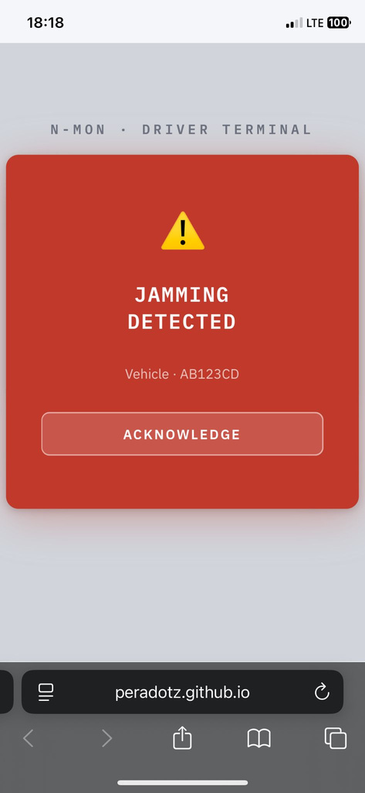

# N-MON: GNSS Jamming Detection and Classification on an Edge Device

N-MON is a vehicle-mounted prototype that detects and classifies GNSS jamming in real time. An SDR captures the GPS L1 band, an embedded NVIDIA Jetson turns the raw I/Q samples into spectrograms and features, a ResNet-18-based classifier identifies the jamming type and power level, and alerts with the vehicle position are sent over MQTT to a driver interface and a control-center dashboard.

Interdisciplinary Project 2025/26, Politecnico di Torino, Group G (Lorenzo Braia, Lorenzo Cavallaro, Simone Peradotto).

<p align="center">
  
  <br><em>The prototype: Jetson Orin Nano, HackRF One and GNSS receiver in a 23 × 16 × 12 cm enclosure.</em>
</p>

---

## Problem

Low-cost GNSS jammers are easy to buy and are used, for example, in cargo theft to make a truck disappear from fleet tracking. Existing monitoring stations are mostly stationary and expensive. The goal was a portable, plug-and-play device that recognises jamming on the vehicle itself, before the GNSS receiver loses its fix, and notifies the fleet operator.

## Solution

| Stage | What happens |
| --- | --- |
| Acquisition | HackRF One samples the L1 band at 10 MHz (complex I/Q) through GNU Radio |
| Pre-processing | Each 100 µs snapshot is converted to a spectrogram (STFT); 16 statistical features (mean, median, std, RMS, percentiles, skewness, kurtosis, entropy) are extracted from a 200 µs window |
| Classification | ResNet-18 on the spectrogram, fused with the 16 features, outputs one of 16 classes |
| Unknown jammers (exploratory) | An Open-Set Recognition (OSR) layer was studied to reject samples whose embedding is too far from the known class centroids |
| Alerting | An alert is published only after 3 consecutive snapshots agree on the same jamming type, to suppress isolated false positives |

**Classes (16):** `CLEAN` + 5 jamming types × 3 Jammer-to-Signal Ratio (JSR) levels (`LOW`, `MID`, `HIGH`).
The 5 types are Linear Narrowband (LN), Linear Wide Fast (LWF), Tick (TICK), Triangular (TRI) and Triangular Wave (TRIW). See [`Deployment/export/class_names.json`](Deployment/export/class_names.json).

## Architecture



### Model

- **Backbone:** ResNet-18 pre-trained on ImageNet. The first convolution is changed to accept a single-channel spectrogram, and the final FC layer is removed, giving a 512-dimensional embedding.
- **Feature fusion:** the 16 hand-crafted features are batch-normalised and concatenated with the embedding, giving 528 dimensions. They then go through 528 → 256 (ReLU, dropout 0.5) → 16 classes.
- **Training:** 44,428 samples with a stratified 50/15/35 train/val/test split. Adam (lr 1e-3), cross-entropy loss, batch size 128 and early stopping (patience 5); training converges within about 20 epochs. See [`ai_model.ipynb`](Dataset_generation/image_dataset_generation/ai_model.ipynb).
- **Deployment:** the model is exported to ONNX and run with ONNX Runtime using the TensorRT execution provider in **FP16**, with CUDA and then CPU as fallbacks. The model weights are not quantised. The spectrogram is rescaled to the int8 value range so it matches the training data, then passed to the network as float32.
- **Open-Set Recognition (feasibility study):** the softmax classifier always assigns one of the 16 known classes, even to jammer types it has never seen. To address this, we studied a distance-based OSR layer:
  - compute class centroids in the 528-dimensional penultimate space;
  - compute the L2 distance from each sample to the centroid of its predicted class;
  - if that distance exceeds a per-class threshold, label the sample `UNKNOWN`.

  Each threshold is taken from a ROC curve, at the point that maximises the acceptance of samples of that class while accepting at most 5% of other-class and unknown samples. Energy scores and Mahalanobis distance were also explored. See [`Deployment/osr_stats.py`](Deployment/osr_stats.py), [`Deployment/build_osr_stats.py`](Deployment/build_osr_stats.py) and [`Deployment/main_remoteTest.py`](Deployment/main_remoteTest.py).

## Results

All numbers come from the final review and the project report in [`Milestones/`](Milestones/), specifically `FR_Team_G_v1.pdf` and `Report_Team_G_v2.pdf`.

### Classification on known jammers

| Test | Result |
| --- | --- |
| Overall accuracy, held-out test set (16 classes) | 95% |
| Hardware-in-the-loop: 500 clean snapshots classified as clean | 97% (the other 3% classified as LOW jamming) |
| Hardware-in-the-loop: jamming at LOW/MID/HIGH JSR, average per-class accuracy | 95% (pass, target ≥ 90%) |
| Hardware-in-the-loop: lowest JSR, per-class accuracy ≥ 90% | 3 of 5 jamming types |

### Unknown jammers (exploratory)

Test set: 2,400 samples (600 each) of 4 jammer types not used to train the classifier: frequency hopping, hooked sawtooth, linear wide slow and multitone narrow.

**Caveat:** the OSR thresholds were calibrated using other samples of these same 4 types, because no further unknown jammer types were available. These figures therefore show that the approach is feasible; they are not a true open-set evaluation. A proper set-up needs a separate pool of unknown jammer types for calibration.

The first and second rows answer different questions:

| Metric | Result |
| --- | --- |
| Without OSR: unknown jammers classified as *some* jamming class (alert raised, wrong type) | 78% |
| With OSR: unknown jammers explicitly flagged as `UNKNOWN` | 32.8% (786 / 2,400) |
| With OSR: unknown jammers that still raise an alert (`UNKNOWN` or a known jamming class) | 63% |
| With OSR: unknown jammers classified as `CLEAN` (missed) | 37% |

OSR performance depends strongly on the jammer type. The share flagged as `UNKNOWN` is 57.3% for multitone narrow, 45.7% for frequency hopping, 15.2% for hooked sawtooth and 12.8% for linear wide slow.

### Latency (Jetson Orin Nano, steady state)

Mean end-to-end pipeline time: **350 ms per snapshot** (the target was ≤ 100 ms, so this test failed).

| Stage | Share |
| --- | --- |
| Feature extraction | 51.6% |
| Spectrogram (STFT) | 30.1% |
| CNN inference | 9.2% |
| int8 input normalisation | 9.2% |

The bottleneck is pre-processing on the ARM CPU (about 82%), not the neural network.

### System tests

| Test | Result |
| --- | --- |
| Continuous I/Q acquisition, position + I/Q streaming, 1-hour autonomous run | Pass |
| Start-up time | 70 s |
| MQTT alert delivery, LWT offline detection, network recovery, multi-vehicle routing | Pass |
| Driver UI / Control Center load time | < 5 s / < 10 s |

### User interfaces

<p align="center">
  
</p>
<p align="center">
  
  &nbsp;&nbsp;
  
</p>
<p align="center"><em>Control Center dashboard (top) and driver interface while monitoring and during an alert (bottom). The vehicle data shown is test data.</em></p>

## Repository structure

```
Dataset_generation/
  GNU_Radio/                 GNU Radio flowgraphs: jammer TX, clean TX, HackRF RX recording
    Jamming_TX/interference_bin/   jamming waveforms replayed by the HackRF
  image_dataset_generation/  signal processing (signal_analysis.py), dataset creation,
                             training notebook (ai_model.ipynb) and earlier experiments
Deployment/                  edge-device code (runs on the Jetson)
  main_optimized.py          main pipeline (default Docker entry point)
  main_optimized2.py         same pipeline with OSR rejection of unknown jammers
  sdr_base.py, sdr_stream.py HackRF streaming via GNU Radio
  signal_analysis_live.py    STFT + feature extraction at runtime
  osr_stats.py, build_osr_stats.py, analyze_osr_performance.py   OSR calibration and evaluation
  export/                    ONNX model, scaler, class names, OSR statistics, config template
  Dockerfile                 image for JetPack 6.2 (L4T r36.4)
NMon_Dataset_10MHz/          scaled feature tables (known and unknown jammers) used for OSR calibration
User Interfaces/
  Driver Interface/          browser UI for the driver (MQTT over WebSocket)
  dashboard_final_deduplicated.py   Control Center dashboard (Streamlit)
Extra/                       test scripts, feature analysis, OSR debug outputs
Milestones/                  review presentations (KO, SRR, PDR, CDR, TRR, FR), report, system requirements
```

## How to run

### 1. Configuration

The MQTT credentials are not in the repository. Copy the template and fill in your own HiveMQ Cloud (or any MQTT over TLS) broker:

```bash
cp Deployment/export/config.example.json Deployment/export/config.json
```

Both user interfaces read a `config.json` from their own directory, so copy the same file there as well.

### 2. Edge device (Jetson Orin Nano, JetPack 6.2)

Hardware: HackRF One and u-blox ZED-F9P connected over USB, plus a GNSS antenna.

```bash
cd Deployment
docker build -t nmon .
```

The container must run with GPU access and access to the HackRF and GNSS receiver over USB. The image installs GNU Radio, gr-osmosdr and `onnxruntime-gpu` from the Jetson AI Lab index, then runs `main_optimized.py`. To enable OSR, run `main_optimized2.py` instead. Per-snapshot timings and predictions are written to `predictions.csv`.

### 3. User interfaces

```bash
cd "User Interfaces"
pip install streamlit paho-mqtt pandas pydeck
streamlit run dashboard_final_deduplicated.py     # Control Center
```

To use the driver UI, serve `User Interfaces/Driver Interface/` with any static web server, for example `python3 -m http.server`, and open `index.html`.

### 4. Training

The training pipeline is in [`ai_model.ipynb`](Dataset_generation/image_dataset_generation/ai_model.ipynb). It was run on Google Colab, and its paths point to the team's Google Drive. The raw recordings (about 100 GB of I/Q data) are not distributed, so reproducing the training requires recording a new dataset with the GNU Radio flowgraphs in `Dataset_generation/GNU_Radio/` and adapting the paths.

## My contribution (Lorenzo Cavallaro)

- **Classification model** ([`ai_model.ipynb`](Dataset_generation/image_dataset_generation/ai_model.ipynb)):
  - built the train/validation/test split, implemented ResNet-18 and trained it on GPU with early stopping;
  - extended the model from 6 classes to 16 (5 jamming types × 3 JSR levels + clean);
  - added the fusion with the 16 hand-crafted features;
  - exported the model to ONNX.
- **Dataset processing** ([`create_dataset_jammer.ipynb`](Dataset_generation/image_dataset_generation/create_dataset_jammer.ipynb), [`test_dataset.ipynb`](Dataset_generation/image_dataset_generation/test_dataset.ipynb)):
  - wrote the code that turns the recorded I/Q samples into spectrograms and feature tables;
  - fixed the alignment between spectrograms and features;
  - integrated new clean recordings from a second antenna.

  The recording campaign itself was a team effort.
- **First live inference pipeline** ([`Deployment/main.py`](Deployment/main.py)):
  - wrote the first end-to-end version: HackRF stream → STFT and features → ONNX inference;
  - ran the first live tests on real signals;
  - added per-stage timing measurements.

  The optimised Jetson version (TensorRT, Docker, MQTT integration) was implemented mainly by my teammates.
- **Open-Set Recognition study:** carried out the exploratory OSR work end to end: energy score, Mahalanobis distance, then centroid distance with ROC-calibrated thresholds, plus the offline evaluation on unknown jammers ([`osr_stats.py`](Deployment/osr_stats.py), [`build_osr_stats.py`](Deployment/build_osr_stats.py), [`analyze_osr_performance.py`](Deployment/analyze_osr_performance.py), [`main_remoteTest.py`](Deployment/main_remoteTest.py)). It showed that the approach is feasible and what data a production version would need.

The MQTT communication layer, the user interfaces, the Docker image and the optimised Jetson pipeline were developed by my teammates.

## Known limitations

- **Latency:** 350 ms per snapshot against a 100 ms target. The CPU-bound pre-processing should move to C++, ARM-optimised DSP libraries or the GPU.
- **Unknown jammers:** OSR is still a feasibility study. Only 32.8% of unknown samples are flagged as `UNKNOWN` and 37% are classified as `CLEAN`, because their embeddings often fall near the `CLEAN` and `TICK_LOW` centroids. On this set the alert rate also drops from 78% without OSR to 63% with it. Next steps are collecting a separate pool of unknown jammer types for calibration and trying stronger OSR methods.
- **Low-power jamming:** at the lowest JSR, 2 of the 5 jamming types are below the 90% per-class accuracy target.
- **Reproducibility:** the full dataset is not public, and the training notebooks use Colab and Google Drive paths.

## Disclaimer

Academic prototype developed for a university course. It monitors and reports jamming; it does not block or counteract it.
